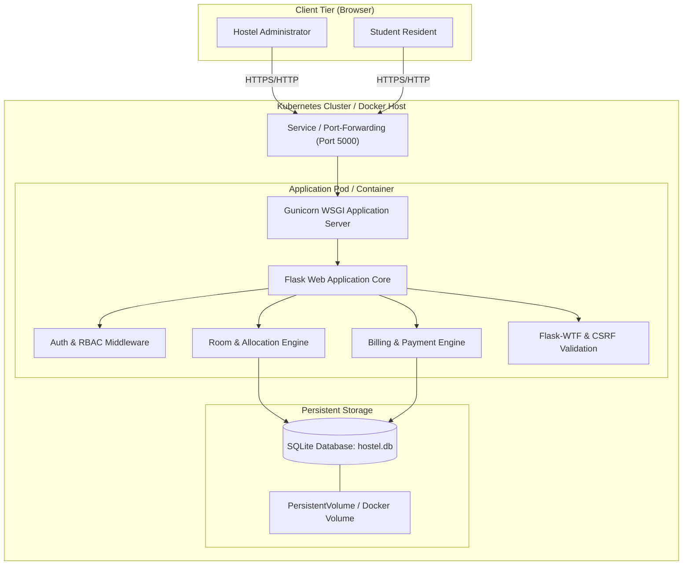

# Application and Deployment Architecture

## 1. System Overview

The **Hostel Management System** is a 3-tier web application built using Python Flask, styled with Bootstrap 5, containerized using Docker, and orchestrated with Kubernetes. It is designed to provide hostel wardens, administrative staff, and college student residents with an intuitive portal for room inventory tracking, occupancy allocation, and billing management.

---

## 2. Architectural Layers

### A. Presentation Layer (Frontend)
- **HTML5, CSS3, JavaScript**: Responsive layout supporting laptops, tablets, and smartphones.
- **Bootstrap 5.3 & Bootstrap Icons**: Clean modern styling using a navy blue (`#0f2b48`), teal (`#0d9488`), and white palette.
- **Jinja2 Templating**: Server-rendered HTML templates with layout inheritance (`templates/base.html`), role-aware navigation bars, context processors, and alert banners.
- **Security Protections**: CSRF tokens embedded in all HTML forms (`{{ form.hidden_tag() }}`).

### B. Business Logic & Application Layer (Backend)
- **Python Flask (WSGI)**: Lightweight web framework handling routing, request parsing, session handling, and response rendering.
- **Role-Based Access Control (RBAC)**: Secure custom decorators `@login_required`, `@admin_required`, and `@student_required` enforcing strict authorization boundaries on every protected endpoint.
- **Validation**: Server-side WTForms validators enforcing length, regex, email formatting, numeric bounds, and equality checks before database execution.
- **Production Server (Gunicorn)**: WSGI HTTP server executing multi-worker Python processes in the production container.

### C. Data Persistence Layer (Database)
- **SQLAlchemy ORM**: Object-relational mapping preventing SQL injection through parameterized execution.
- **SQLite Database (`database/hostel.db`)**: High-performance, zero-configuration relational database stored on a persistent volume mount (`/app/database`).
- **Entity Relationships & Constraints**:
  - `User` $\leftrightarrow$ `StudentProfile` (1:1 with cascade delete)
  - `Room` $\leftrightarrow$ `RoomAllocation` (1:N with restrict-on-delete to preserve occupancy history)
  - `StudentProfile` $\leftrightarrow$ `RoomAllocation` (1:N)
  - `StudentProfile` $\leftrightarrow$ `RoomRequest` (1:N)
  - `StudentProfile` $\leftrightarrow$ `Bill` (1:N)
  - `Bill` $\leftrightarrow$ `Payment` (1:N with cascade)
  - `UniqueConstraint('student_id', 'fee_type', 'billing_period')`: Enforces the business rule preventing duplicate monthly bills.

---

## 3. Deployment Architecture

### A. Docker Containerization
- **Base Image**: Official `python:3.11-slim` image providing a minimal attack surface and small image size (~150MB).
- **Non-Root Execution**: Database directory creation with unbuffered standard output for clean log aggregation.
- **Persistent Volume**: Named Docker volume (`hostel_management_db_data`) mounted to `/app/database` ensuring student accounts, rooms, and payments remain intact across container restarts and rebuilds.
- **Health Check**: Native container health check invoking `curl -f http://localhost:5000/health` every 30 seconds.

### B. Kubernetes Orchestration
- **Namespace (`hostel-system`)**: Logical isolation boundary separating application resources from cluster system services.
- **ConfigMap (`hostel-config`)**: Decoupled non-sensitive configuration parameters (`FLASK_ENV`, `DATABASE_DIR`).
- **Secret (`hostel-secret`)**: Sensitive session cryptographic keys and admin initialization credentials.
- **PersistentVolumeClaim (`hostel-db-pvc`)**: Dynamic volume storage request binding 1Gi of persistent storage for the database.
- **Deployment (`hostel-deployment`)**:
  - Declares desired pod state with automated recovery.
  - Resource requests (100m CPU, 128Mi RAM) and limits (500m CPU, 512Mi RAM).
  - Liveness and readiness probes hitting `/health` to automate failure detection and zero-downtime routing.
  - Single-replica topology ensures SQLite database file lock safety.
- **Service (`hostel-service`)**: NodePort service abstracting Pod IP volatility and exposing port 5000 to the host network.
